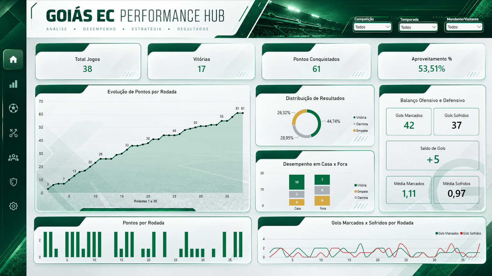
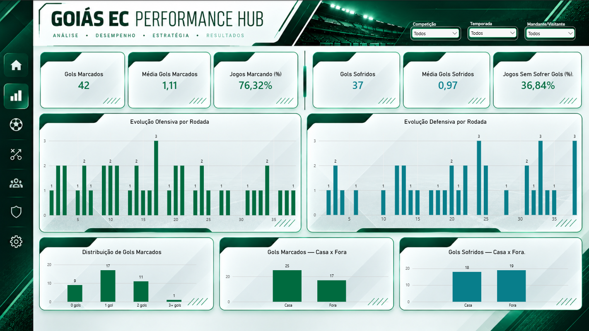
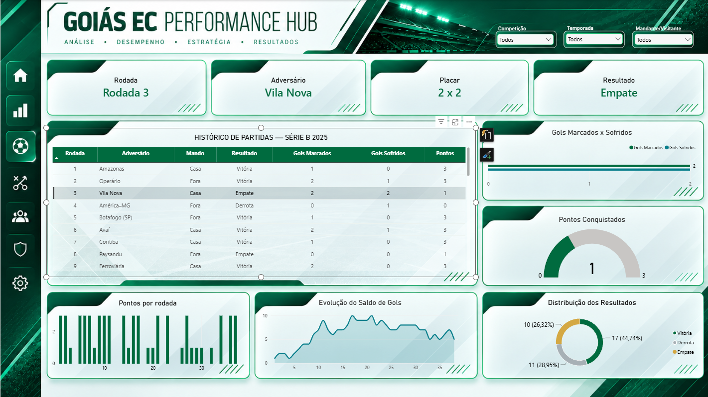
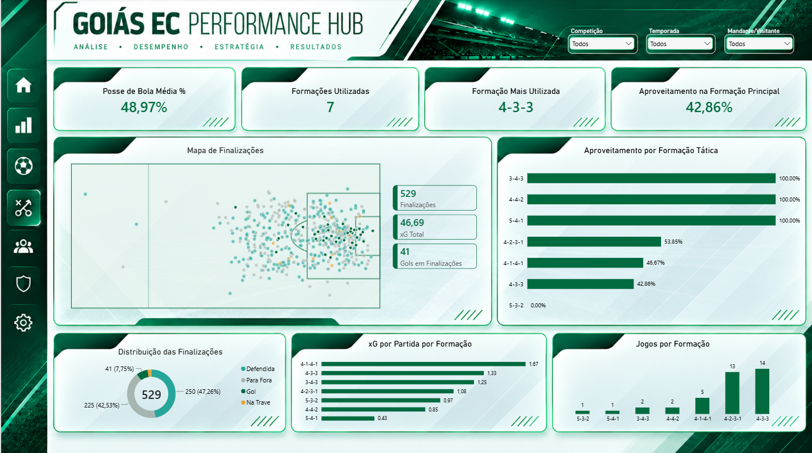
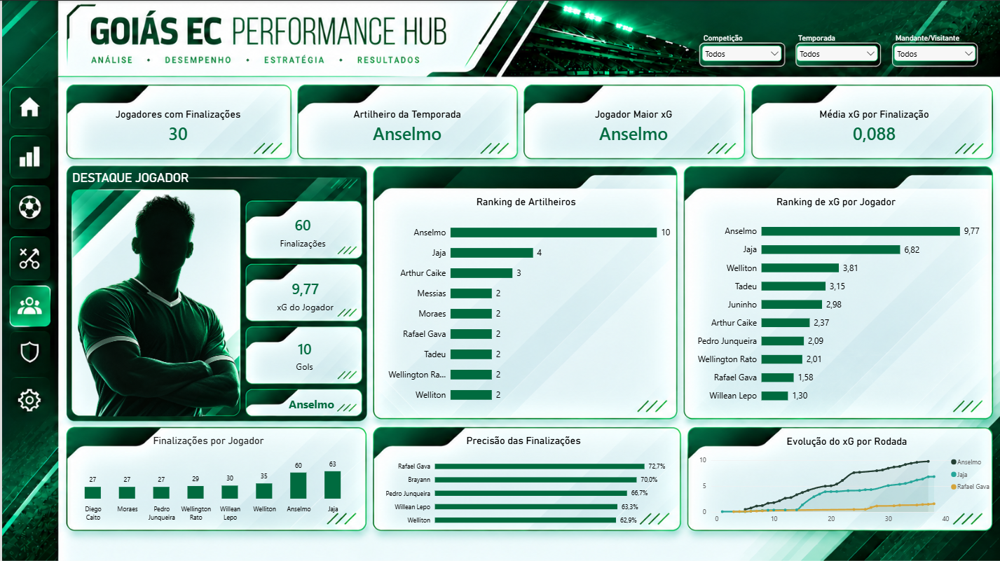

## Goiás EC Performance Hub
## Análise de desempenho do Goiás Esporte Clube na Série B de 2025, desenvolvida no Power BI.

Este projeto reúne indicadores de resultados, desempenho ofensivo e defensivo, análise de partidas, formações táticas e desempenho individual dos jogadores em um dashboard interativo de cinco páginas.

## Objetivo
Organizar dados de partidas e finalizações em uma visão analítica que facilite a comparação de indicadores, a identificação de padrões e a exploração do desempenho da equipe ao longo da competição.

## Visão geral dos dados 
  Indicador	Resultado
  
  Partidas analisadas -	38
  
  Vitórias -	17
  
  Empates -	10
  
  Derrotas - 11
  
  Pontos conquistados -	61
  
  Gols marcados (registro oficial das partidas) -	42
  
  Gols sofridos	- 37
  
  Finalizações registradas - 529
  
  xG total	- 46,69
  
  Jogadores com finalizações - 30

Nota metodológica: a base de eventos de finalização registra 41 gols em finalizações, enquanto a tabela de resultados das partidas registra 42 gols marcados. Essa diferença deve ser considerada ao comparar métricas entre as duas fontes; pode estar associada a um gol contra, conforme a conciliação realizada no projeto.

## Páginas do dashboard
  1. Visão geral: indicadores consolidados de resultados e desempenho na temporada.
  2. Análise ofensiva: exploração dos indicadores de produção ofensiva.
  3. Análise defensiva e partidas: acompanhamento de desempenho defensivo e resultados por jogo.
  4. Análise tática e finalizações: formações utilizadas, aproveitamento, distribuição e localização das finalizações, além de xG por formação.
  5. Análise individual de jogadores: rankings de gols, xG, volume e precisão de finalizações, evolução do xG acumulado e destaque individual.

## Principais análises
  - Anselmo: 10 gols, 9,77 xG e 60 finalizações. A diferença entre gols e xG foi de +0,23.
  - Jajá: maior volume de finalizações, com 63.
  - Rafael Gava: 72,7% de precisão das finalizações no ranking de jogadores com pelo menos 10 tentativas, conforme o campo no_alvo da base.
  - Formações táticas: comparação entre frequência de uso, aproveitamento e xG por partida.
  - Finalizações: análise espacial das tentativas e da distribuição por tipo de resultado.
    Os indicadores podem variar conforme os filtros aplicados no relatório.

## Metodologia de dados
O fluxo de preparação incluiu extração de dados com Python e tratamento e limpeza com Python, antes da construção do modelo analítico e das visualizações no Power BI. As transformações e validações foram utilizadas para preparar as informações de partidas e finalizações para análise.

## Tecnologias e recursos
  - Python: extração, tratamento e limpeza dos dados utilizados no projeto.
  -   Power BI: modelagem, visualizações, segmentações e interatividade.
  -   DAX: criação de medidas, indicadores, rankings e cálculos acumulados.
  - Power Query: preparação e transformação dos dados, conforme as etapas presentes no projeto.
  - Deneb / Vega: visualização personalizada do mapa de finalizações.Prévia do dashboard

## Visualização do Dashboard

  Página 01 — Visão Geral
  
  Página 02 — Performance Coletiva
  
  Página 03 — Análise de Partidas
  
  Página 04 — Análise Tática
  
  Página 05 — Análise Individual de Jogadores
  

Como explorar
  1. Baixe o arquivo .pbix da pasta dashboard/, quando disponibilizado.
  2. Abra-o no Power BI Desktop.
  3. Navegue pelas cinco páginas e utilize os filtros de temporada, competição e mando.
  4. Explore os gráficos e rankings para comparar resultados e jogadores.

Observações
Este é um projeto independente de portfólio, sem vínculo oficial com o Goiás Esporte Clube. Antes de disponibilizar o arquivo .pbix, os dados brutos ou fotografias, verifique as permissões de uso e compartilhamento das respectivas fontes. Imagens geradas ou editadas por IA devem ser identificadas como tal quando utilizadas.
